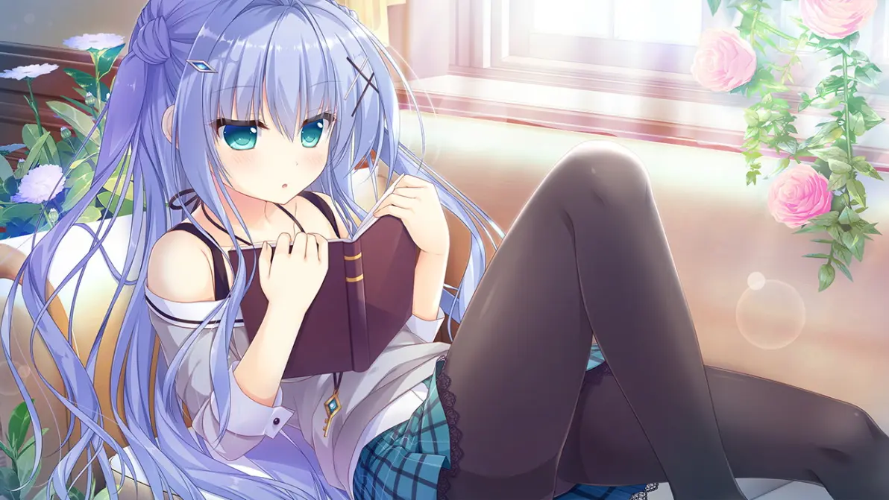
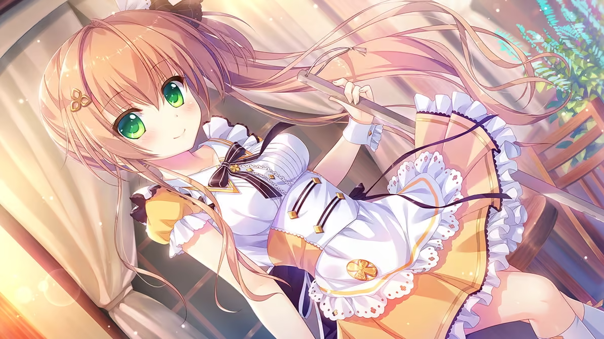
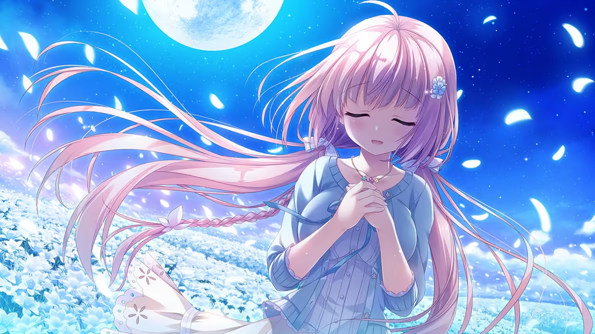
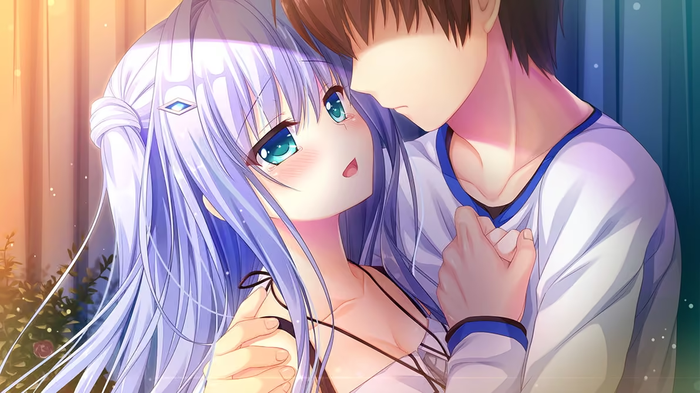
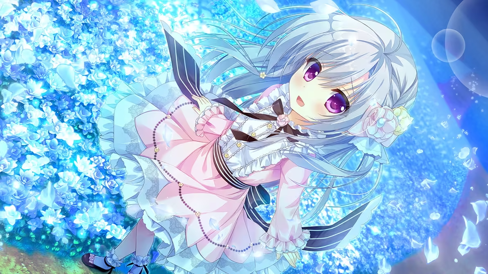

>2026.11.21 10:47

每当我打完废萌的一条线路，我往往难以忘怀那条线路的主角。出于调换思维，我往往会选择一些短篇的带有一些剧情向的作品来换换脑子。在打完了哈密达西的锦亚澄线路之后。我便投入游玩了本作。

---------

## 剧情，还是废萌？

很多时候，废萌和剧情作仿佛就像两个极端。衡量他们的办法往往是看剧情的水平以及风格。而《枯れない世界と終わる花》这部作品给我带来的感受很明显不能用一个简单的"废萌向"或者"剧情向"来形容。如果硬要讨论的话，《枯れない世界と終わる花》的剧情内容其实很简单：一个家人侠在"约定"的支撑下，破除这个不合理的世界，创造了一个大家都幸福的世界。

一个简单的故事，不是吗？对于萌萌人来说确实是一个好的、简单的却又引人泪下，让人感动的故事。独特的插叙，虽然可能对很多人来说会让人感到云里雾里。但是对打完了摸鱼的我来说，倒是可以接受。而且插叙的叙述让我也算是比较简单的猜出了男主的过往以及拯救家人的决心从何而来。

那么，剧情其实算是平庸，那就应该把它归为"废萌"吗？我看也未必。说到底，我觉得一部galgame，如果他的剧情让我能够拥有跟随着探寻、玩下去的冲动，能够给我带来感动，那么它便可以称之为"剧情作"。我很容易的猜出了剧情的走向，但是它也确实给我带来了感动。这就足够了。

为了拯救深受"代价"的家人，一次次为家人们斩断、承受天使力量的代价：

---------

### 忘却"悲伤"的长姐

作为故事线中，男主最先拯救的对象。在和琴濑的挚友麻耶交流下，也在琴濑对小说的感想中，天使力量的侵蚀，让琴濑失去了感受"悲伤"情绪的能力。她一直披着"长女"的铠甲，故作坚强地把所有重担往自己肩上揽，连哭泣的权利都被天使之力剥夺。直到麻耶用生命留下那部遗作，琴濑那层失去了悲伤的的心灵才终于变得完整——眼泪落下来的那一刻，她才算真正找回了"悲伤"的温度。

### 对"家人"含义的信任崩塌

雪菜的故事则从插叙的故事中窥见一二：从小流浪，以偷盗为生，在被小时候的秋人救赎邀请来到家中成为家人后，肖突如其来的离去让她再一次破碎了好不容易建立起来对待家人的信任和爱。她从此封闭了自己的内心，失去了从身边感受到家人"爱"的能力。在邻居明里逝去前的对她报以女儿的态度和见证了肖离去的真相，在崩溃之后，重新找回了对于"家人"的信任和"快乐"的情感：不再强颜欢笑，而是发自内心的感受美好。

  

### 记录于日记之中，执着的约定

春的病症，则是来自于日记带给她的执念。因为自己的记忆受到天使之力的侵蚀影响，每天都需要用日记的文字维系自己对于世界的记忆，也是日记中的文字，让她记住了本应该忘记的约定。两人相识的羁绊，一起守护家人、相互支撑的过往。以及无论如何希望对方获得幸福而宁可牺牲自己的信念。我认为是让人能够引发情感共鸣的泪点。也确实让人潸然泪下

### end？

在最后，自然是主角背负着所有的力量，和莲一起，用生命的代价~~并非献出生命~~，创造了一个没有悲痛和代价的世界。自然是可喜可贺，可喜可贺啊。

---------

## 傲娇vs萝莉？

说实话，驱动我一开始玩《枯れない世界と終わる花》的动力，其实就是莲。谁不喜欢一个可爱的吵吵闹闹的白毛小萝莉呢？
但是在剧情走向下，我还是选择了琴濑的部分，无他，傲娇的反差和角色的人设深得我心。
于是我们得到了一个有意思的比对：傲娇VS萝莉。说实话，我觉得我的xp其实更加注重人物的塑造，而非所谓"标签"的堆砌
比起单纯看人设标签，这种被故事一点点打动后的喜欢，才更戳人吧。而且很奇妙的是，推过的作品越多，我越发觉一个规律：最后真正走进我心里的，往往不是当初吸引我点开游戏的那个‘封面角色’。慢慢去体验剧情里的血肉塑造，再去邂逅那个真正让你心动的灵魂，这种意外的惊喜，也是推 Galgame 的乐趣之一。

---------

### 傲娇的力量

既然说到琴濑是在这部里面选择交往的角色，那我想来谈论一下她的魅力：为何能够吸引我
我想，离不开的一个缘故是她的傲娇(？)
姐姐身份下，是一颗渴求爱与关怀的心。

<figure>
  
  <figcaption>傲娇nb</figcaption>
</figure>

我恰恰觉得，这种依赖的反差感和角色塑造的风格是让她为我喜欢的一个缘故。当然也少不了其人物设计(姐系真不赖吧)

### 萝莉的反差

至于广为<a href="#" title="真的是大众吗">大众</a>~~萝莉控~~所喜爱的莲，也是非常的~~软糯美味~~讨人喜爱。而且CV也是我喜爱的秋野花，虽然揭示身世由来的时候带来了~~并不意外~~反转。但是作为本作的毒舌吐槽役和白毛小萝莉的人设加成，也是让人能够从心里感受到这个角色的天真可爱，也是许多人喜欢上莲的动机。

<figure>
    
    <figcaption>莲可爱捏</figcaption>
</figure>

---------

## 富有氛围感的配乐

说到底，在我眼里，一部 Galgame 只要能勾起我一路探寻下去的念头、能实实在在地戳中我的泪腺，那它就称得上是‘剧情作’。哪怕它的插叙不算难懂，甚至让我早早猜透了男主的过往和故事的走向，但当那些伏笔真正收束、感情喷涌出来的那一刻，它还是狠狠地打动了我。

**这就足够了。**

---------

在以转换思路的动机下，这篇早已下载却搁置的galgame也是终于画上了句号。那么接下来，是什么样的故事让我有兴趣前往窥见呢？不得而知。但是我仍然期待着下一个故事能够给我带来恋爱的甜蜜，亦或者发自心灵的感动。
